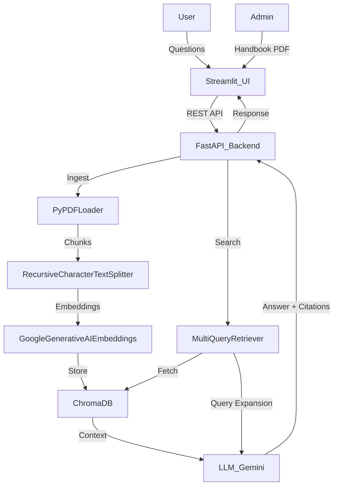

# MirAI Policy Advisor

## Overview
A production-quality autonomous RAG application that serves as a student policy advisor for Mirai School of Technology. It answers student queries based strictly on the provided handbook PDF.

## Features
- **FastAPI Backend**: Handles PDF ingestion and chat queries with REST endpoints.
- **Streamlit Frontend**: Clean, professional interface for students to ask policy questions.
- **RAG Pipeline**:
  - `PyPDFLoader` for document ingestion
  - `RecursiveCharacterTextSplitter` for chunking
  - `GoogleGenerativeAIEmbeddings` for vector embeddings (model: `models/text-embedding-004`)
  - `ChromaDB` for local vector storage
  - `MultiQueryRetriever` for query expansion and improved semantic retrieval
  - `ChatGoogleGenerativeAI` for grounded answer generation (model: `gemini-3.8-flash`)
- **Evaluation**: LLM-as-a-judge pipeline to evaluate against required certification tests.

## Architecture


## Setup & Installation

1. Create and activate a Python virtual environment:
   ```bash
   python3 -m venv venv
   source venv/bin/activate
   ```

2. Install dependencies:
   ```bash
   pip install -r requirements.txt
   ```

3. Setup environment variables:
   Copy `.env.example` to `.env` and add your Google API Key.
   ```bash
   cp .env.example .env
   # Edit .env and insert your GOOGLE_API_KEY
   ```

## Running the Application

1. **Start the FastAPI Backend**:
   ```bash
   uvicorn backend:app --reload
   ```

2. **Start the Streamlit Frontend** (in a new terminal):
   ```bash
   streamlit run frontend.py
   ```

## Usage
1. Open the Streamlit UI in your browser (usually `http://localhost:8501`).
2. Use the **Sidebar** to upload the `Mirai School of Technology Student Policy Handbook 2026.pdf` and click **Ingest PDF**.
3. Ask questions in the main chat interface or click on the example questions.

## Running Evaluations
To run the automated LLM-as-a-judge evaluation for the 4 audit tests:
```bash
python evaluation.py
```
This will generate `rag_eval_scores.csv` with the results.


